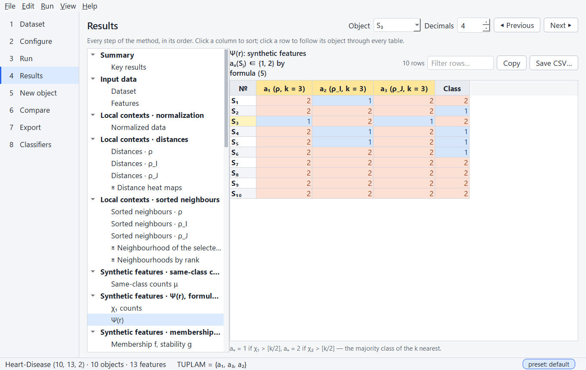

# Context-synthetic recognition

Python implementation of the **context-synthetic model of recognition algorithms (CS-model)** of
the author's article (in preparation) — a library, the `csr` command line and a desktop GUI. The
article is the specification: the defaults follow it. The author's Excel experiment on
Heart-Disease (10, 13, 2) remains an acceptance test, reproduced cell for cell with its own
settings.

> **Windows app, no Python needed:** download `csr-gui-<version>-windows.zip` from the
> [latest release](https://github.com/ktuhtabayev/context-synthetic-recognition/releases/latest),
> unpack it and start `csr-gui.exe`.

```text
E₀ —R-IPS→ E, T      (S, E) → Ψ_ρ,k(S, E) → D(S, E) → Y(S, E) → R(Y(S, E))
```

## The method

| Stage | What it does | Package |
|---|---|---|
| R-IPS | forms the precedent base: hyperspheres around the objects split E₀ into a training sample E and a test sample | `core/rips` |
| Local contexts Ψ_ρ,k | normalization fitted on E; base operators (the Zhuravlyov metric on all, quantitative and nominal features); nested neighbourhoods; admissible values of k | `core/local_context` |
| Synthetic features Ψ(r) | formula (5) from the classes of the k nearest neighbours; membership (1), stability (2) and the metaobject, boundary (3), informativeness ω (4), contributions η (6) | `core/synthetic_features` |
| Additional (latent) features d₁ … d_p | the hierarchical agglomerative algorithm, Steps 1–5, with the majorizing function φ and the margin regularization parameter α | `core/additional_features` |
| Meta-algorithm R | Steps 1–5 on the meta-description Y: class K1, K2 or refusal | `core/meta_algorithm` |

A new object is represented and classified without its class (Theorem of the article): the
classification methods have no label argument. Terms and symbols are listed in the
[glossary](docs/glossary.md).

## Presets and switches

| Preset | Settings |
|---|---|
| `default` | the article: odd k = 3 … min(\|K1\|, \|K2\|), final class means, one majorizing pass in Step 4; where the article gives no value, α = 0.3, δ = 0.1, ϰ = 5, cr1₀ = 10 and φ = logistic sigmoid (ADR-068) |
| `alpha-0.1`, `alpha-0.2` | the default with α = 0.1 or 0.2, the values of the article's experiments |
| `excel-experiment` | the Excel experiment: odd k = 3 … 2·min\|Kᵢ\| − 3, ⚠ running class means, ⚠ two majorizing passes; reproduces the workbook |

Four switches deviate from the article when they are on. They are off by default and marked ⚠
in the command line, the GUI and every export:

| Switch | The article (default) | ⚠ Deviating value | Decision |
|---|---|---|---|
| `rips.keep_blocked_cover` | `false` | `true` — a blocked object keeps covering other objects with \|r(S)\| | ADR-061 |
| `rips.training` | `remaining` — the objects left in E₁ | `moved` — the objects R-IPS moves to D | ADR-061 |
| `additional_features.class_means` | `final` — M₁, M₂ | `running` — θ and γ from running partial class means | ADR-002 |
| `additional_features.majorizing_passes` | `1` | `2` — φ applied twice in Step 4 | ADR-003 |

## Quick start (Windows PowerShell)

The project is developed, tested and supported on Windows only (ADR-049).

```powershell
git clone https://github.com/ktuhtabayev/context-synthetic-recognition.git
cd context-synthetic-recognition
py -3.12 -m venv .venv
.\.venv\Scripts\python.exe -m pip install --upgrade pip
.\.venv\Scripts\python.exe -m pip install -e ".[dev]"
```

```powershell
.\.venv\Scripts\csr.exe fit heart-disease-10            # admissible k, Ψ(r), the agglomerative algorithm step by step, TUPLAM
.\.venv\Scripts\csr.exe run heart-disease-10            # resubstitution, leave-one-out, k-NN baselines, margins, properties
.\.venv\Scripts\csr.exe gui                             # the desktop application
```

More commands:

```powershell
.\.venv\Scripts\csr.exe config show --preset excel-experiment   # a preset as YAML
.\.venv\Scripts\csr.exe config init my-experiment.yaml          # start a configuration file
.\.venv\Scripts\csr.exe config check my-experiment.yaml         # hash, preset, deviations, plug-ins
.\.venv\Scripts\csr.exe data list                               # datasets, built-ins, file formats
.\.venv\Scripts\csr.exe data info heart-disease-270             # sizes, types I/J, |Kᵢ|, admissible k, r
.\.venv\Scripts\csr.exe classify heart-disease-10 --object 1    # S₁ left out of its own context
.\.venv\Scripts\csr.exe classify heart-disease-10 --values "58 1 3 125 250 0 2 150 0 1 2 1 7"  # a new object
.\.venv\Scripts\csr.exe run heart-disease-10 -c configs\excel-experiment.yaml --sensitivity     # the workbook's settings and the four switch settings
.\.venv\Scripts\csr.exe run heart-disease-10 --export all       # … and export: workbook, tables, figures, report
.\.venv\Scripts\csr.exe export -f excel,html                    # export the latest run again
.\.venv\Scripts\csr.exe validate --against "tests\data\workbooks\Excel experiment [Heart-Disease (10, 13, 2)].xlsx"
```

`csr validate` reads the data, the parameters and the switch settings from the workbook, runs the
pipeline with the `excel-experiment` preset and compares every computed sheet: 11,622 cells in
579 checks. The two check workbooks — additional features and meta-algorithm — are compared the
same way ([Reproducing the Excel experiment](docs/reproduction.md)).

`csr run` evaluates the model and writes a run folder: resubstitution (Definition 2) and
leave-one-out with the whole pipeline re-fitted per fold by default; the protocols `rips`
(the R-IPS split, Definition 3) and `nested-cross-validation` are chosen in the configuration
([Evaluation](docs/evaluation.md)). `csr export` writes a run as an Excel workbook in the layout
of the Excel experiment, as CSV/JSON, Markdown and LaTeX tables, figures and an HTML/PDF report
([Exporting](docs/exporting.md)). `csr gui` does all of this in a desktop application, in English,
Russian or Uzbek ([Desktop application](docs/gui.md)).

The article's computational experiment — R-IPS samples, Tables 1–6 and the k-NN comparison on
Heart (270, 13, 2) and German (1000, 20, 2) — is rebuilt by `scripts\run_experiments.py`; the
results do not reach the article's printed accuracies
([Computational experiment](docs/experiments.md)).



From Python:

```python
from context_synthetic_recognition.config import preset
from context_synthetic_recognition.core.model import fit_model
from context_synthetic_recognition.data import load_builtin
from context_synthetic_recognition.services.runner import run_experiment

data = load_builtin("heart-disease-10")
model = fit_model(data)  # the article's settings
model.trace.admissible_k.ks  # (3,)
model.agglomerative.label  # '{a₁, a₃, a₂}'
model.meta_table.columns  # ('y₀ (a₁)', 'y₁ (a₃)', 'y₂ (a₂)', 'd₁', 'd₂')
result = model.classify(new_objects)  # no label argument (Theorem)
result.decisions  # 1 = K1, 2 = K2, 0 = refusal

workbook = fit_model(data, preset("excel-experiment"))
workbook.agglomerative.label  # '{a₆, a₃, a₁, a₂, a₄}'
evaluation = run_experiment(data, preset("excel-experiment"))  # resubstitution + leave-one-out
evaluation.metrics(evaluation.protocol("leave-one-out").predictions).accuracy  # 0.2
```

Tests and checks:

```powershell
.\.venv\Scripts\python.exe -m pytest --cov
.\.venv\Scripts\ruff.exe check .
.\.venv\Scripts\mypy.exe
```

## Layout

```text
configs/            configuration files: default, alpha-0.1, alpha-0.2, excel-experiment,
                    heart-disease-270-large-data
datasets/           the author's datasets: default (10, 13, 2), raw/<Heterogeneous|Nominal|
                    Quantitative>/<Family>/ (Heart-Disease, German, Spambase, …);
                    splits/ = training and test samples (the article's, Spambase's)
docs/               documentation (mkdocs): glossary, algorithm reference, DECISIONS.md, …
experiments/        the article's computational experiment: results/*.csv, summary.json, checksums;
                    comparison/ = Tables 7 and 8 (standard classifiers)
scripts/            run_experiments.py, run_comparison.py, build_exe.py, gui_screenshots.py,
                    update_translations.py
src/context_synthetic_recognition/
  core/             pure numerical core (no I/O), one package per stage of the method:
    rips/                 R-IPS: hyperspheres, algorithm, selection
    local_context/        metrics, normalizers, operators, neighbours, admissible k
    synthetic_features/   Ψ: psi (the fitted operator), encoders (formula (5)), membership,
                          contributions, bit representations
    additional_features/  the hierarchical agglomerative algorithm, majorizing functions
    meta_algorithm/       the meta-algorithm
    model.py, trace.py    the CS-model end to end; trace objects
  evaluation/       protocols, baselines, metrics, ROC, margins
  comparison/       Tables 7 and 8: standard classifiers on the article's samples
  config/           typed configuration (schema 2), presets, the switches
  data/             dataset schema, loaders, built-in datasets, split files
  services/         runner, run folders, validation against the workbooks, switch sensitivity,
                    dataset summaries — shared by the CLI and the GUI
  export/           Excel workbook, tables (CSV, JSON, Markdown, LaTeX), figures, report
  gui/              desktop application (PySide6); it computes nothing itself
  cli/              the csr command
tests/              pytest suite; tests/data/workbooks = the author's Excel workbooks,
                    tests/golden = acceptance tests and an independent re-implementation
```

## Documentation

<https://ktuhtabayev.github.io/context-synthetic-recognition/>

- [Architecture](docs/architecture.md) · [Algorithm reference](docs/algorithm-reference.md) ·
  [Glossary](docs/glossary.md) · [Reproducing the Excel experiment](docs/reproduction.md) ·
  [Computational experiment](docs/experiments.md) ·
  [Standard classifiers](docs/comparison.md) · [Datasets](docs/datasets.md) ·
  [Evaluation](docs/evaluation.md) · [Exporting](docs/exporting.md) ·
  [Desktop application](docs/gui.md) · [Extending](docs/extending.md) ·
  [Decisions](docs/DECISIONS.md) · [Development](docs/development.md)

The article is in preparation and is not part of this repository.

## License

MIT — see [LICENSE](LICENSE).
