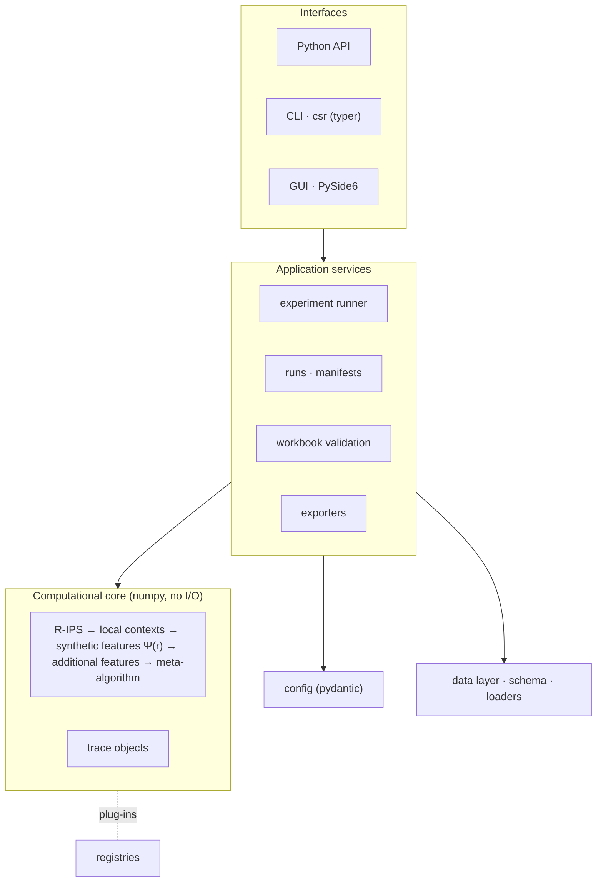
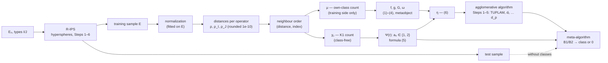
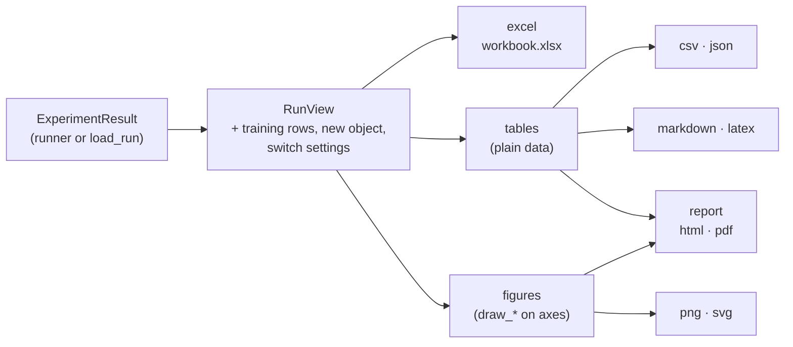
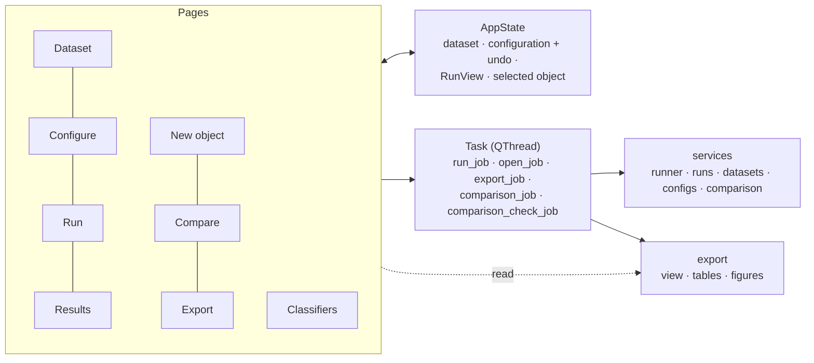

# Architecture

## Layers

The computational core is pure and deterministic: it reads no files and shows nothing. Everything
that touches files, users or screens sits above it. The CLI and the GUI call the same services;
the GUI computes nothing itself.

| Package | Role |
|---|---|
| `core` | The method, one subpackage per stage (below); the model end to end, trace objects, model properties, plug-in registries |
| `config` | Typed configuration (schema 2), presets, the switches that deviate from the article, YAML/TOML/JSON, hash |
| `data` | Dataset schema, loaders (experiment workbook, extended layout, CSV/XLSX/Parquet), the dataset folder, built-in datasets, split files with a training/test flag, hashing |
| `evaluation` | Protocols (resubstitution, the R-IPS split, nested cross-validation, leave-one-out, k-fold, hold-out), metrics, AUC/ROC, margins, baselines |
| `comparison` | Tables 7 and 8: SVM, random forest and k-NN on the article's training and test samples, through the baselines; apart from the CS-model's pipeline (ADR-079) |
| `services` | Experiment runner, run folders that can be repeated, validation against the workbooks, switch sensitivity, dataset summaries, configuration checks, the comparison's files and their check |
| `export` | Excel workbook in the layout of the Excel experiment, CSV/JSON, LaTeX/Markdown, figures, report |
| `cli` | The `csr` command: `fit`, `classify`, `run`, `export`, `validate`, `gui`, `config`, `data`, `compare` |
| `gui` | Desktop application (PySide6, optional extra `[gui]`) |

### The core, stage by stage

| Subpackage | Stage of the article | Modules |
|---|---|---|
| `core.rips` | R-IPS — forming the precedent base | `hyperspheres` (r(S), g(S), 1/r(S), the queue), `algorithm` (Steps 1–6, blocking, counter correction), `selection` (R-IPS on a dataset: proximity measure, normalization on E₁) |
| `core.local_context` | local contexts Ψ_ρ,k | `normalizers`, `metrics`, `operators` (metric × feature subset), `neighbours` (order by distance, ties to the smaller index), `admissible_k` (K̂) |
| `core.synthetic_features` | synthetic features Ψ(r) | `psi` (the fitted operator Ψ), `encoders` (formula (5); the own-class counts μ), `membership` ((1)–(4)), `contributions` ((6)), `bit_representations` (class-sequence masks, majority chains) |
| `core.additional_features` | additional (latent) features d₁ … d_p | `agglomerative` (the hierarchical agglomerative algorithm, Steps 1–5), `majorizing_functions` (φ) |
| `core.meta_algorithm` | the meta-algorithm R | `algorithm` (Steps 1–5, B1/B2, refusal, decision rules) |
| `core` | the model | `model` (`fit_model`, `CSModel`), `trace` (trace objects), `properties` (Definitions 1, 4, 6; the Theorem) |

## Pipeline and information flow

`fit_model` fits the model on the training sample it is given; R-IPS runs before it in the
protocols `rips` and `nested-cross-validation` (`core.rips.selection.select_precedents`), and the
other protocols split the sample their own way ([Evaluation](evaluation.md)).

The class of an object enters only through μ, which feeds the training-side formulas (1)–(4) and
the bit representations. A new object reaches the meta-algorithm through χ₁ and formula (5) alone
(Theorem, ADR-009): its class is not an argument of `represent`, `classify` or `predict`.

## Trace objects

Every intermediate result is captured as immutable data: the R-IPS hyperspheres and each of its
iterations; normalized data, distance and rank matrices; neighbour blocks with μ and χ₁; Ψ(r),
f/g, the metaobject, the class-sequence masks and majority chains, ω, η; each iteration of the
agglomerative algorithm with every candidate's b, class means, θ, γ and θ/γ; the meta-algorithm's
B1/B2 per step; margins and metrics. The GUI tables, the exporters and the golden tests read the
same trace, so the software, its exports and the workbook checks cannot drift apart.

## Exporters

`export.view.RunView` is the one thing every exporter reads: the evaluated experiment with every
training object classified, the new-object demonstration and — when evaluated — the four settings
of the two switches of the agglomerative algorithm. `export.tables` turns it into plain tables
that the text formats and the report share; `export.excel` lays it out in the layout of the
experiment workbook (sheet builders in `sheets_*.py`, a palette of named styles, a writer that
detects overlapping tables); `export.figures` draws on axes it is given, so the GUI reuses the
drawings; `export.report` arranges tables and figures into a document and renders it as HTML and
PDF. Formats are plug-ins of the `EXPORTERS` registry ([Exporting](exporting.md), ADR-036 –
ADR-043).

## Desktop application

The package `gui` adds no computation. Pages change the shared `AppState` and listen to its
signals; a run, the opening of a saved run and an export are plain functions over the services,
run in a worker thread; tables and figures are the exporters' own, shown through a Qt model that
adds the workbook's colour semantics. Plug-in parameter forms are generated from the parameter
types ([Desktop application](gui.md), ADR-044 – ADR-048).

## Extension points

Every exchangeable part is a plug-in chosen by name. The table lists what is built in; the last
column names what the design leaves room for but does not ship.

| Kind | Default | Also built in | Not built in |
|---|---|---|---|
| metrics | Zhuravlyov on all / I / J (and in R-IPS) | weighted Zhuravlyov, HEOM, Gower; Manhattan, Euclidean, Chebyshev, Minkowski, Canberra, cosine, Mahalanobis on I; Hamming on J (ADR-050, ADR-051) | HVDM — it reads class labels (ADR-051) |
| normalizers | min–max to [0; 1] (training data), per operator if set (ADR-066) | none, z-score, robust, max-abs, decimal scaling, rank, unit length (ADR-052) | — |
| k strategies | `min-class`: odd k = 3 … min\|Kᵢ\| (ADR-063) | `twice-min-class` (the Excel experiment), `range`, `explicit` | — |
| encoders | formula (5) | — | μ, class-sequence masks and majority chains read the object's class or describe the training sample; they are not encoders (ADR-021, ADR-067) |
| informativeness | ω by formula (4) | — | — |
| majorizing functions | logistic sigmoid (ADR-068) | tanh, arctan, softsign, scaled to (0, 1) (ADR-026) | — |
| decision rules | the meta-algorithm's Step 4 (refusal = 0) | — | — |
| protocols | resubstitution, leave-one-out | `rips`, `nested-cross-validation` (ADR-069), stratified k-fold, repeated k-fold, hold-out (ADR-032) | — |
| baselines | k-NN vote | scikit-learn classifiers (extra `[sklearn]`, ADR-032) | — |
| dataset formats | detected from the file | experiment workbook, extended layout, CSV, Excel, Parquet (ADR-018) | — |
| export formats | all | Excel workbook, CSV, JSON, Markdown, LaTeX, figures, HTML, PDF (ADR-036 – ADR-043) | — |

Plug-ins register by name in a `Registry`; external packages add them through the entry-point
group `context_synthetic_recognition.<kind>` ([Extending](extending.md)).
