# Desktop application

The desktop application takes an experiment through the whole workflow — **Dataset → Configure →
Run → Results → New object → Compare → Export** — and shows every table and figure of the
method for any dataset. An eighth page, **Classifiers**, apart from the workflow, gives the
comparison with standard classifiers in three steps: training, the test objects classified without their
class, and the evaluation. The application computes nothing itself: a run is the same
`run_experiment` the command line uses, and the pages show the same tables and figures the
exporters write, so the screen, the Excel mirror and the article's tables cannot disagree.

```powershell
.\.venv\Scripts\python.exe -m pip install -e ".[gui]"     # PySide6 (included in ".[dev]")
.\.venv\Scripts\csr.exe gui                               # the project's default dataset
.\.venv\Scripts\csr.exe gui heart-disease-270 -c configs\heart-disease-270-large-data.yaml
.\.venv\Scripts\csr.exe gui --run runs\20261001_120000_5a0c7b92   # open a saved run
.\.venv\Scripts\csr-gui.exe                               # the same, without a console window
```

**Without Python.** Each release has a Windows build, `csr-gui-<version>-windows.zip`
([Releases](https://github.com/ktuhtabayev/context-synthetic-recognition/releases)): unpack it
anywhere and start `csr-gui.exe` — nothing is installed. The built-in Heart-Disease datasets are
included; your own datasets are opened from their files. The build also carries scikit-learn and
the article's split files, so the *Classifiers* page works there (ADR-081). Only Parquet files
need an extra the build leaves out, and the application says so when one is opened.
`csr-gui.exe --self-test report.txt` checks an installation without showing a window: it loads
every language, runs the default experiment, draws a table and a figure, exports the run,
computes the comparison tables and writes what it found to the report (exit code 0 = everything
works).

!!! warning "Four switches deviate from the article"
    The defaults follow the article. Four switches deviate from it when on: in R-IPS, blocked
    objects that keep covering (`rips.keep_blocked_cover`) and the moved set D as the training
    sample (`rips.training: moved`, ADR-061); in the agglomerative algorithm, running class means
    (ADR-002) and two majorizing passes in Step 4 (ADR-003). The application never lets an active
    one out of sight: the status-bar button "⚠ deviates from the article: n setting(s)" (click it
    to see them), a warning box at the top of *Configure*, a "⚠ deviates from the article" badge
    beside each switch, the ⚠ rows of *Compare*, and the *Switch sensitivity* table and figure of
    the results. **Edit → Apply a preset → excel-experiment** turns on the two switches of the
    agglomerative algorithm, as the Excel experiment workbook does.

## 1 · Dataset

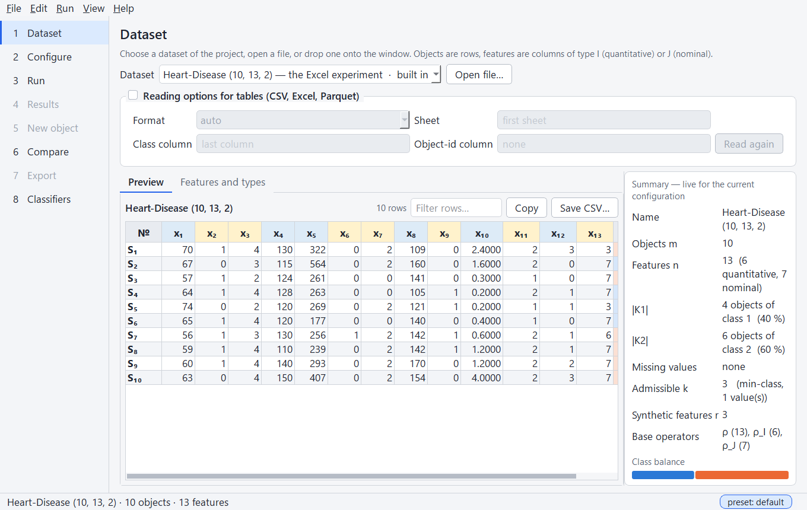

Choose a dataset of the project's `datasets` folder or a built-in one, open a file
(**Ctrl+O**), or drop a file onto the window. The preview shows objects × features; the header of
a column is blue for a quantitative feature (set I) and yellow for a nominal one (set J), the
class column is tinted by class.

- **Features and types** — the type of every feature decides how it enters the distance. Change
  it in the *Type* column; the dataset is read again and the summary updates.
- **Reading options** — for tables (CSV, Excel, Parquet): the format, the sheet, the class column
  (default: the last column) and an optional object-id column, then *Read again*. A dataset with
  missing values is not loaded; the message names the cells.
- **Summary** — live for the current configuration: |K1| and |K2|, the class balance, the
  admissible k and r = |Ψ(r)|. If the model would be undefined for the data (no admissible k, more
  than two classes), the summary says why.

## 2 · Configure

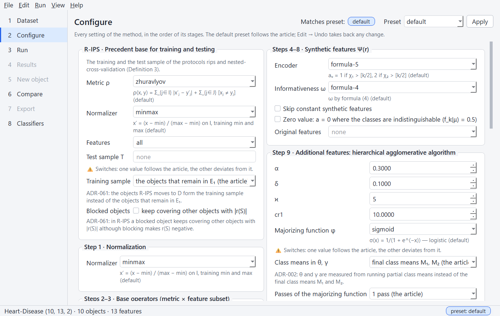

Every setting of the method, grouped by the stages of the pipeline. Plug-ins — normalizer,
metric, k rule, encoder, informativeness, majorizing function, decision rule, protocols,
baselines — are chosen from their registries, and each plug-in's parameters appear as a form generated from its parameter type, so a
plug-in added to a registry shows up here by itself.

- **Presets** — choose `default` (the article), `alpha-0.1`, `alpha-0.2` (the article's
  experiments) or `excel-experiment` (the workbook's settings) and press *Apply*, or use
  **Edit → Apply a preset**; the dataset, the name, the seed and the output folder stay. The list
  shows the preset the configuration matches.
- **R-IPS** — the metric ρ, its normalizer and feature subset, the test sample T as object ids
  separated by commas (`S1` is read as `S₁` when the dataset names its objects so), the training
  sample (the objects remaining in E₁, or ⚠ the moved set D) and ⚠ blocked objects that *keep
  covering*. A repeated object of T is marked at once, an unknown one is listed among the problems.
- **Base operators** — a label, a metric, a feature subset (`all`, `quantitative`, `nominal`, or
  feature names separated by commas) and, on a second line, the operator's own normalization
  ("as the local contexts" by default, ADR-066). Labels must be unique. A metric defined on
  quantitative features (Euclidean, Mahalanobis, …) or on nominal ones (Hamming) must get a
  subset of that type; otherwise the problem list names the features that do not fit.
- **Admissible k** — the rule (by default odd k = 3 … min|Kᵢ|, the article) and, live, the k it
  gives for the loaded dataset and the resulting number of synthetic features.
- **Synthetic features** — the encoder (formula (5)), the informativeness ω (formula (4)), the
  zero value of the article's experiments (ADR-064) and original nominal features combined with
  the synthetic ones (ADR-065).
- **The ⚠ switches** — each in the group of its stage, with its ADR, and marked "⚠ deviates from
  the article" while it is on.
- **Validation** — problems (an invalid parameter, a k rule that permits nothing, an unknown object
  of the test sample, no protocol) are listed at the top and keep *Run* disabled.
- **Undo / redo** — every edit can be taken back (**Ctrl+Z**, **Ctrl+Y**).
- **Files** — **File → Open configuration…** (**Ctrl+Shift+O**) reads a YAML, TOML or JSON
  configuration and loads the dataset it names; **Save configuration as…** (**Ctrl+S**) writes
  one.

## 3 · Run

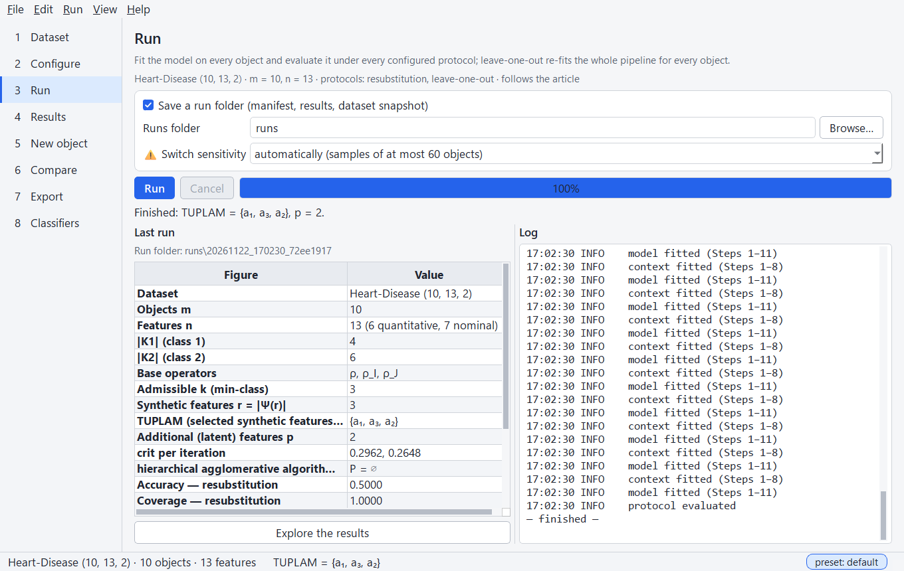

**Run** (**F5**) fits the model and evaluates it under every configured protocol in a background
thread: the window stays responsive, the progress bar follows the folds, the log shows what the
pipeline reports, and **Cancel** (**Shift+F5**) stops at the next fold.

- **Save a run folder** — writes `runs/<time>_<hash>/` with the manifest, the results and the
  dataset snapshot ([Evaluation](evaluation.md)); a saved run can be opened again and compared.
- **⚠ Switch sensitivity** — also evaluates all four settings of the two switches of the
  agglomerative algorithm (a leave-one-out each): automatically for samples of at most 60 objects,
  always, or never. The two switches of R-IPS are not part of it.

When the configuration is edited after a run, the pages say that the results on screen belong to
another configuration until the experiment is run again.

## 4 · Results

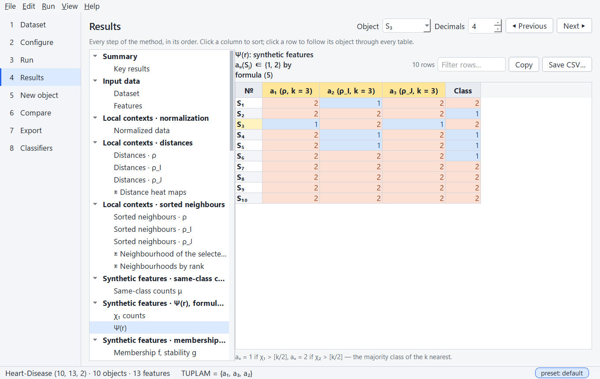

The stages of the method as a tree — *Input data*, *Local contexts*, *Synthetic features*,
*Additional features*, *Meta-algorithm*, *Evaluation*, *Checks* (ADR-078): every stage with its
tables and, marked ▣, its figures — among them the metaobject, the class-sequence masks and the
majority chains (ADR-067, ADR-074).
**Previous** / **Next** (**Alt+←**, **Alt+→**) walk through them in order.

Tables use the colour semantics of the Excel mirror:

| Colour | Meaning |
|---|---|
| blue / yellow header | quantitative (I) / nominal (J) feature |
| light green header | synthetic feature aᵤ |
| yellow header or row | a feature of TUPLAM; the chosen candidate q of an iteration of the agglomerative algorithm |
| strong green header | additional feature dⱼ |
| blue / orange cell | class K1 / K2 — also aᵤ = 1 / aᵤ = 2, the class a neighbourhood votes for |
| green / red / grey cell | correct / wrong decision / refusal (0); ✓ / ✗ status |

- **Sorting** — click a column header (numbers sort numerically, S₁₀ after S₉); a table opens in
  pipeline order.
- **Formula tooltips** — a column header names what it holds and the article's formula
  ("Informativeness ω — formula (4)").
- **Cross-highlighting** — click a row, or choose an object in the *Object* selector: the object
  is marked in every table, and *Neighbourhood of the selected object* draws its neighbours with
  the nested k-neighbourhoods.
- **Filter, copy, save** — filter rows by text, copy the selected rows (**Ctrl+C**, pastes into
  Excel), save the table as CSV at full precision; the file opens correctly in Excel ("—", α and
  the subscripts included, ADR-083). *Decimals* changes only what is shown.

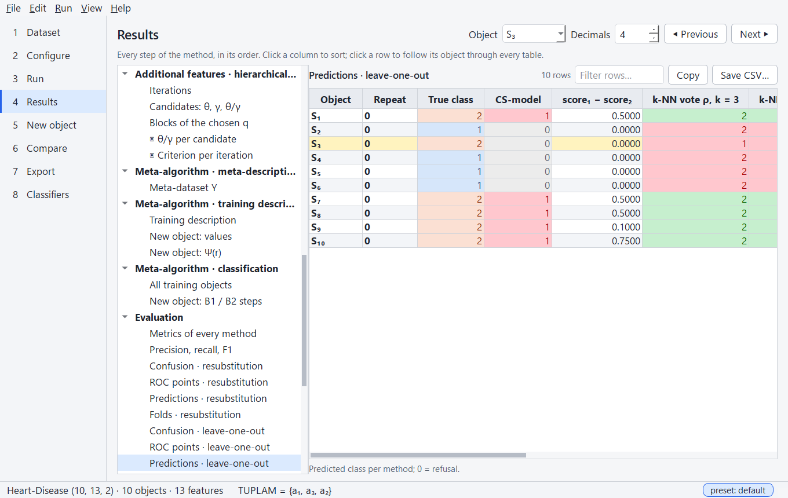

Figures are interactive (zoom, pan, the value under the cursor) and can be saved as PNG, SVG or
PDF at the export size.

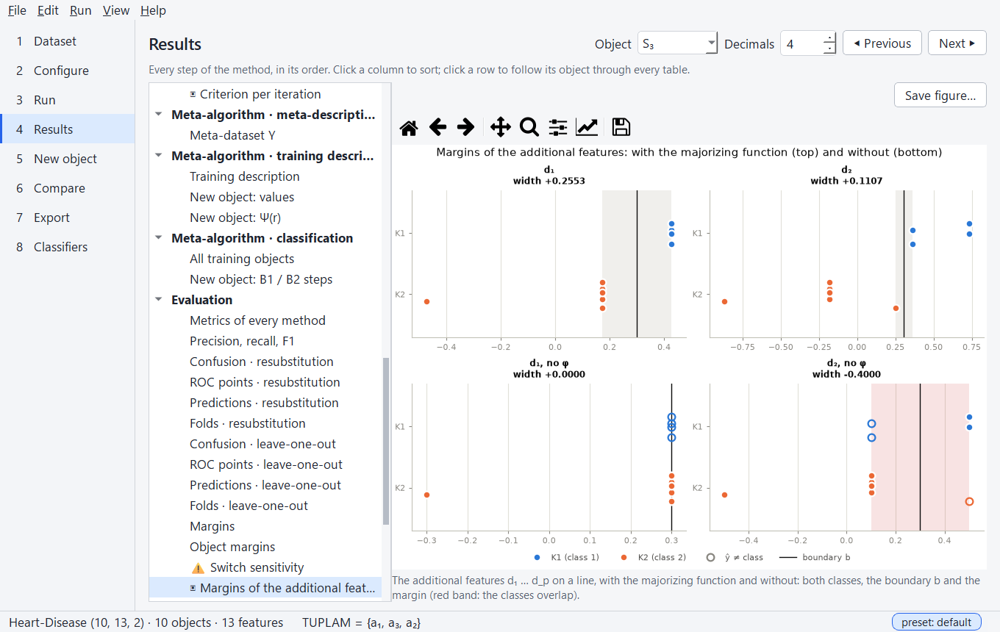

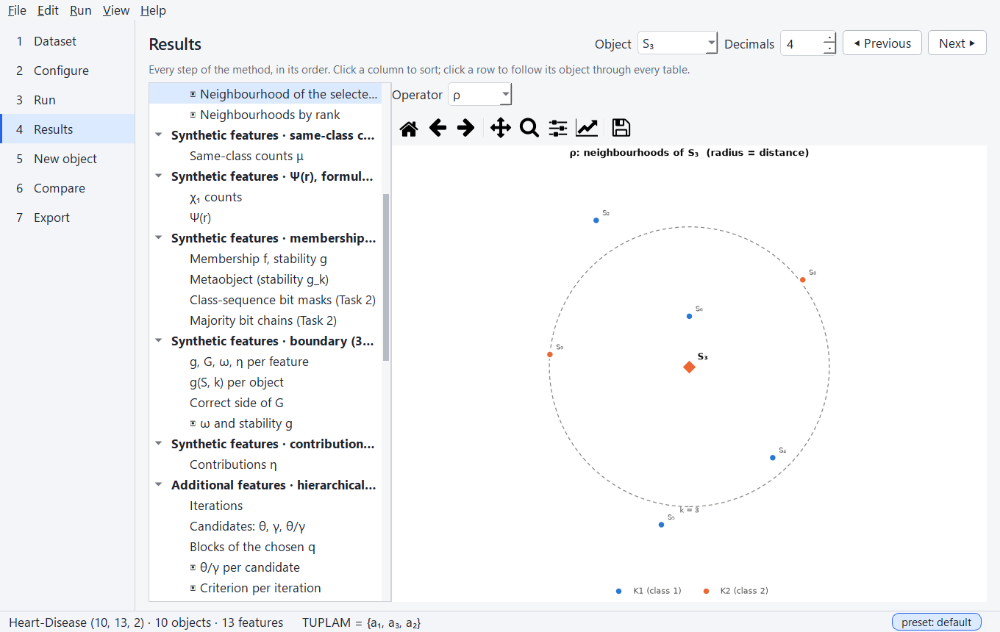

## 5 · New object

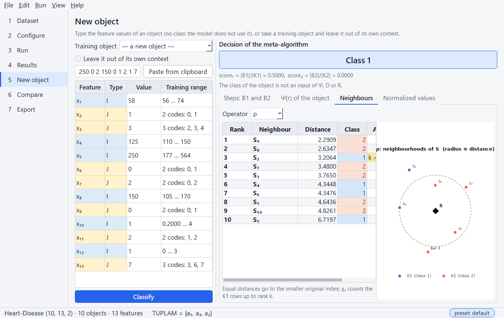

Type the feature values of an object — there is no class input: the model does not use it — or
paste a row (commas, semicolons, spaces or tabs), or take a training object. *Leave it out of its
own context* repeats the Theorem check: the object must get the representation and the
decision of its training row.

**Classify** shows the decision with score₁ and score₂ and explains it: B1 and B2 at every step
of the meta-algorithm, the object's Ψ(r) with χ₁ and χ₂, its neighbours under every operator with
the admissible k marked, and its normalized values. The classified object also becomes the object of
the *New object* tables of the results and of the exports.

## 6 · Compare

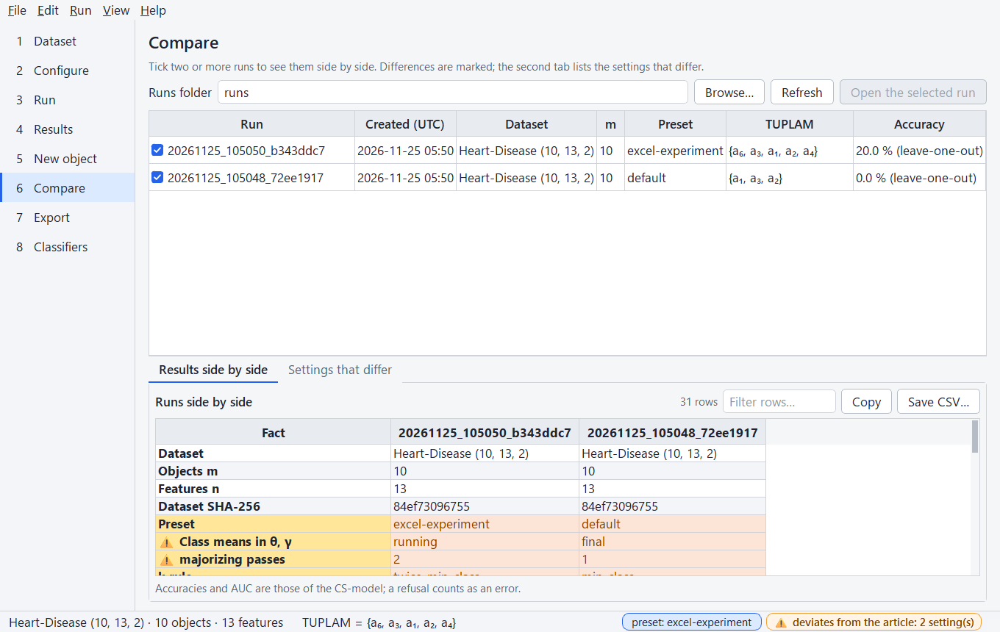

The runs of the runs folder, newest first (a result that was not saved is listed as *current*).
Tick two or more: the key facts appear side by side with the differing rows marked, and *Settings
that differ* lists the configuration settings that are not the same. *Open the selected run*
repeats a run from its folder and shows all its tables and figures.

## 7 · Export

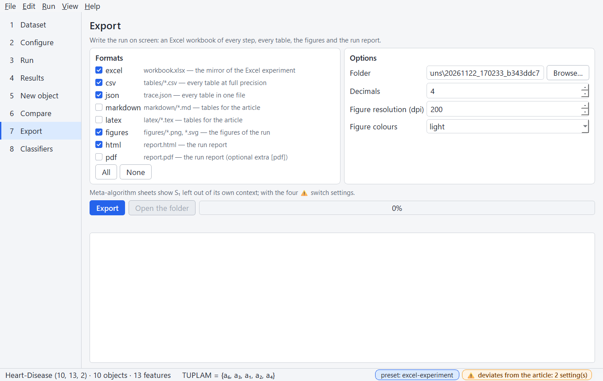

Writes the run on screen in the ticked formats — the Excel mirror, CSV, JSON, Markdown, LaTeX,
figures, the HTML and PDF report ([Exporting](exporting.md)) — into the run folder (or a folder of
your choice) in the background, and lists what was written and what was left out because of its
size. The CSV files open correctly in Excel.

## 8 · Classifiers

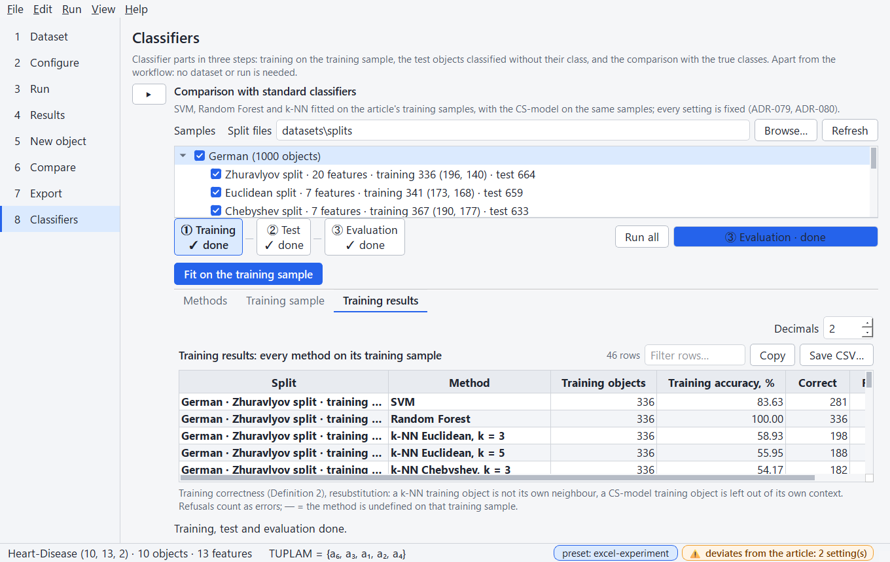

Classifier parts in three steps, apart from the workflow: the page needs no dataset and no run
(ADR-084). The list of parts on the left starts collapsed while there is one part; **▶** opens
it. The first part is the comparison with standard classifiers: SVM, Random Forest and k-NN
fitted on the article's training samples, with the CS-model on the same samples
([Standard classifiers](comparison.md)). Every setting is fixed (ADR-079, ADR-080): the page
shows them and offers none to change.

- **Samples** — a tree of the datasets and their splits, built from every split file of
  *Split files* (`datasets\splits` of the project; [Adding a split file](comparison.md#adding-a-split-file)).
  The datasets are in alphabetical order with their object count; under each, its splits by
  training size, each with its metric, its number of features (the splits of one dataset can
  differ), its training sample and its test size (ADR-091):

  ```text
  ▾ ☑ German (1000 objects)
      ☑ Zhuravlyov split · 20 features · training 336 (196, 140) · test 664
      ☑ Euclidean split · 7 features · training 341 (173, 168) · test 659
      ☑ Chebyshev split · 7 features · training 367 (190, 177) · test 633
  ▸ ☐ Heart-Disease (270 objects)
  ▸ ☐ Spambase (2102 objects)
  ```

  Ticking a dataset ticks all its splits, and a dataset with some of them ticked shows the
  partial mark; you can tick one split, a whole dataset, or splits of several datasets. The
  arrow keys move and **Space** ticks. German's three splits are ticked by default. A file that
  cannot be used — its name does not follow the pattern, its content breaks the split-file
  convention ([File layout](comparison.md#file-layout)), or its header contradicts its name — is
  greyed under its dataset, without a checkbox; its tooltip gives the reason, the file and the
  row. The tree is read again when the page is shown, when the split folder changes and with
  **Refresh**; the ticks are kept for the splits still there.

  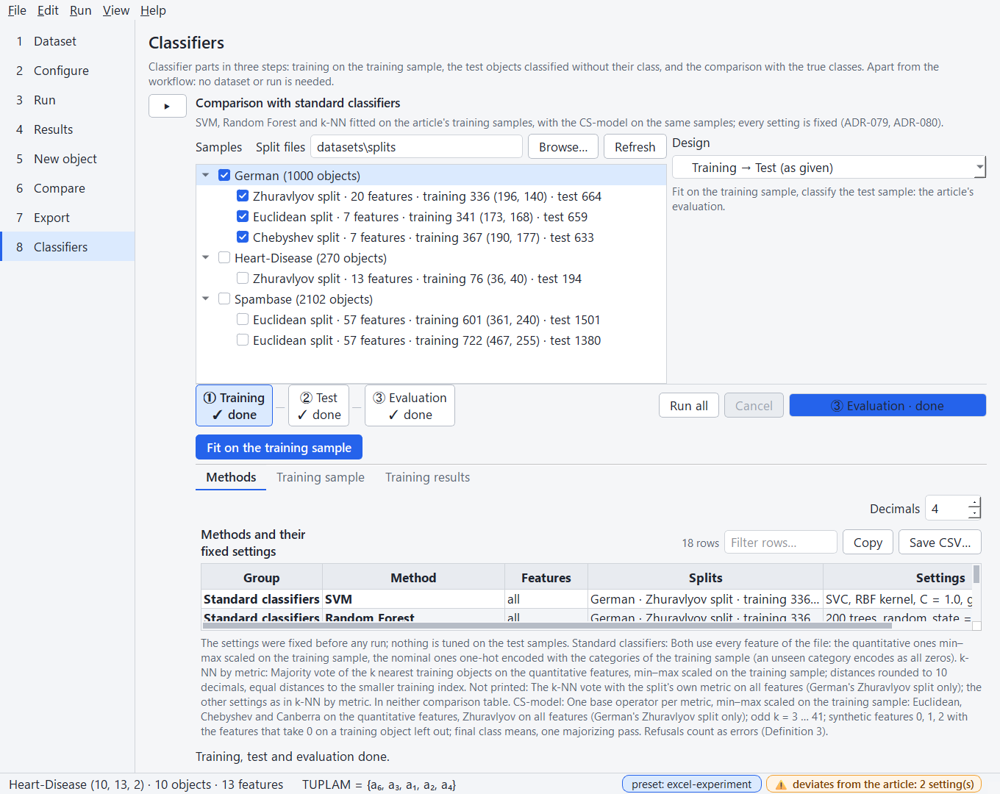
- **The steps** — ① *Training*, ② *Test* and ③ *Evaluation*, each with its state as a symbol
  and a word: ○ not run, ◔ running, ✓ done, ⟳ out of date (an earlier step was run again, or the
  samples changed), ⊘ unavailable (the tooltip says why). A step opens when the step before it is
  done; **Alt+←** and **Alt+→** move between the steps. *Run all* runs the three steps in a row,
  and the progress bar names the step and the split.

| Step | Button | Tabs |
|---|---|---|
| ① Training | *Fit on the training sample* | *Methods* (the methods as in the article, each with its own fixed settings; a long text shows in full in its tooltip), *Training sample* (the objects, their features and class: K1 blue, K2 orange), *Training results* (training accuracy as in Definition 2, correct, refusals) |
| ② Test | *Classify the test sample* | *Test objects* (feature values only — there is no class column), *Predictions* (1 / 2 / 0 per object and method, coloured by the predicted class, with the scores, the most common decision and how many methods give it), *Predicted classes* (K1, K2 and refusals per method, counts and shares) |
| ③ Evaluation | *Compare with the true classes* | *Standard classifiers*, *k-NN by metric*, *CS-model*, *All results* (as `csr compare run` writes them), *Per object* (✓ correct, ✗ wrong, 0 refusal), *Confusion* (true class × decision and refusals per method), *Check* |

The banner of ② says that the classes are hidden: the test objects are classified from their
feature values alone, and nothing in that step needs or shows a true class. The banner of ③ says
that the true classes are revealed. The *Standard classifiers*, *k-NN by metric* and *CS-model*
tables need exactly German's three splits; with any other ticks these tabs say which splits they
need, and *All results* shows every ticked split. Every split is named by its dataset —
"German · Euclidean split · training 341 (173, 168)" — in the progress, the status line, the
tables' *Split* column and the *Split* selector above a per-split table; Spambase's two
Euclidean splits differ in their training sizes.

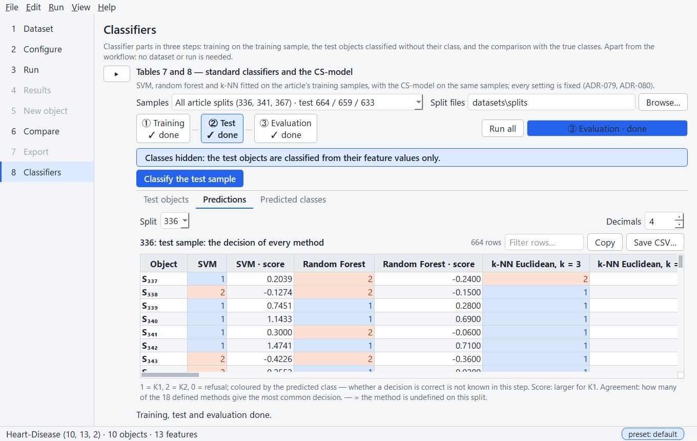

In ③, *Write the files* writes the comparison with its checksums to the results folder
(`experiments\comparison`) — for German's three splits only, the files of `csr compare run`;
`csr compare run --split KEY --out DIR` writes another split.
*Check the written files* compares a results folder with its checksums and a new run, byte for
byte, as `csr compare check` does; *Open the folder* shows it. The CSV files open correctly in
Excel. Per-split tables have a *Split* selector; every table can be sorted, filtered, copied and
saved, and clicking an object marks it in every table of the step.

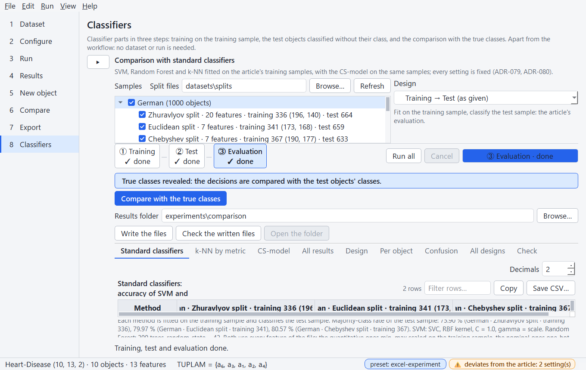

*Per object* in the dark theme: ✓ and ✗ mark every decision, so the colours are never the only
cue.

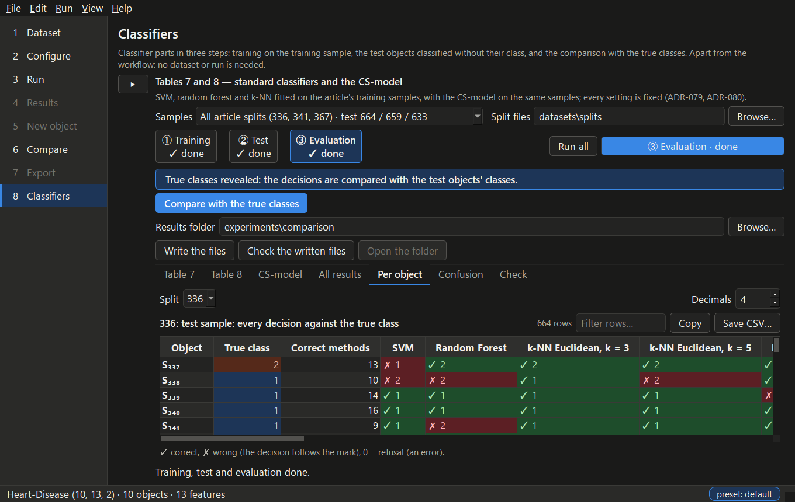

The page needs scikit-learn and the split files. The Windows build carries both, and without a
project folder it writes to `experiments\comparison` under the folder it runs in (ADR-081).
From source, install the `[sklearn]` extra and start the application in the project, whose
`datasets\splits` it reads. A new part is registered in the services and appears in the list
without a change to the page ([Adding a part to the Classifiers page](extending.md#adding-a-part-to-the-classifiers-page)).

## Appearance and what is remembered

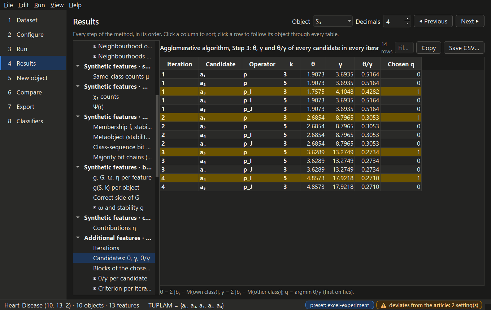

- **View → Light theme / Dark theme** (**Ctrl+T**); tables and figures follow.
- **View → Zoom in / Zoom out / Actual size** (**Ctrl++**, **Ctrl+−**, **Ctrl+0**) scales the
  whole interface.
- The window size, the theme, the zoom, the language, the runs folder, the recent datasets,
  configurations and runs (**File → Recent …**), and the part and the ticked samples of the
  *Classifiers* page are remembered between sessions. A remembered sample that no longer exists
  is dropped silently, and when none is left the default ticks apply.
- The colours of the classes and of the figures are colour-blind safe. Correct / wrong use the
  Excel mirror's green and red and are never the only cue: the predicted and the true class are both
  written, a refusal is the value 0, and statuses carry ✓ / ✗ / ⚠.

## Language

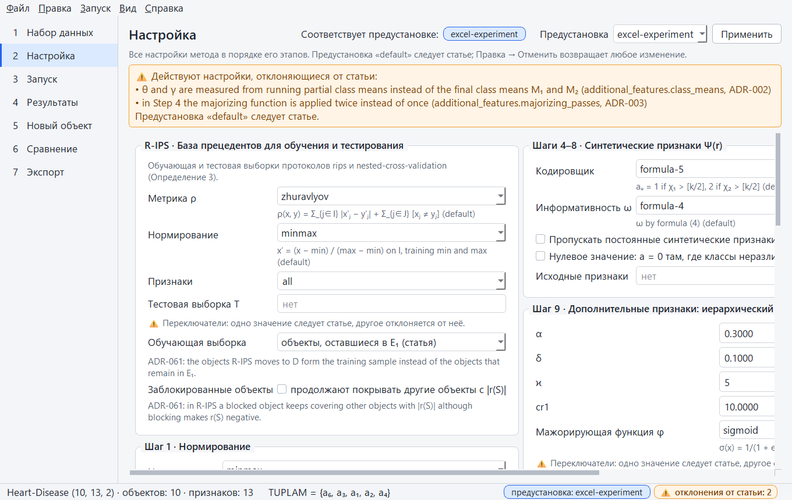

**View → Language** offers *System language*, English, Русский and Oʻzbekcha (Latin script). The
window changes at once and keeps what you are working on — the dataset, the configuration with
its undo history, the run and the selected object; the choice is remembered. *System language*
follows the language of Windows and falls back to English. While a run or an export is in
progress the language stays as it is.

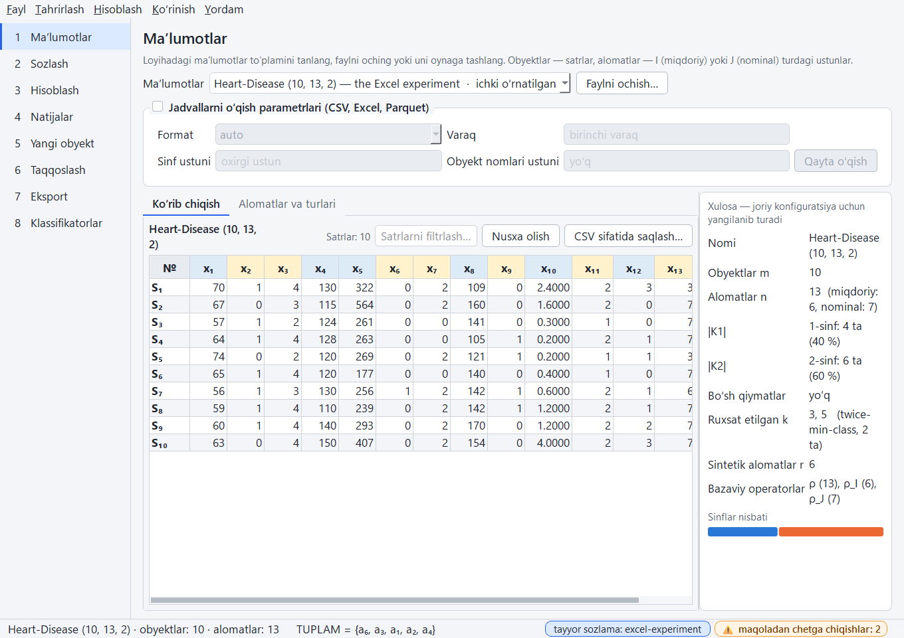

Only the interface is translated — menus, pages, buttons, forms, messages. What the exporters
produce stays in English, in the application too: the tables and figures of *Results*, the
explanation on *New object*, and every exported file. The names of plug-ins and their formulas
(`minmax`, `zhuravlyov`, …) are the names used in configuration files and are not translated
either (ADR-054).

## Keyboard shortcuts

| Keys | Action |
|---|---|
| Ctrl+O | Open a dataset |
| Ctrl+Shift+O | Open a configuration |
| Ctrl+S | Save the configuration |
| Ctrl+Shift+R | Open a run folder |
| F5 | Run the experiment |
| Shift+F5 | Cancel the run |
| Ctrl+E | Export |
| Ctrl+Z / Ctrl+Y | Undo / redo a change of the configuration |
| Ctrl+1 … Ctrl+8 | Go to a page |
| Alt+← / Alt+→ | Previous / next table or figure of the results; previous / next step of the *Classifiers* page |
| Ctrl+C | Copy the selected table rows |
| Ctrl+T | Switch between the light and the dark theme |
| Ctrl++ / Ctrl+− / Ctrl+0 | Zoom in / out / reset |
| F1 | Keyboard shortcuts |
| Ctrl+Q | Quit |

## For developers

The package `gui` is one more interface above the services ([Architecture](architecture.md)):

- `state.AppState` — the dataset, the configuration (with its undo stack), the run on screen and
  the selected object; pages talk only through it.
- `workers` — `run_job`, `open_job` and `export_job` are plain functions over the services; a
  `Task` runs one in a thread and reports through signals.
- `models`, `widgets`, `canvas` — the exporters' tables as a Qt model with the colour semantics;
  the table and figure panels.
- `forms` — parameter forms generated from the plug-ins' parameter types.
- `theme` — one palette per theme for the style sheet, the cell colours and the figures.
- `i18n` — every string passes through `tr()`; a constant shown later (a page title) is marked
  with `mark()`. The translations are `gui/translations/csr_ru.ts` and `csr_uz.ts`, compiled into
  the `.qm` files the application loads; `scripts\update_translations.py` keeps them in step with
  the code and the tests fail if a text is missing ([Development](development.md#translations)).
  Changing the language rebuilds the window on the same `AppState` (`app.rebuild_window`).

The screenshots of this page are made by `scripts\gui_screenshots.py`, which drives the real
application; the tests (`pytest -m gui`) drive it the same way without a display.
